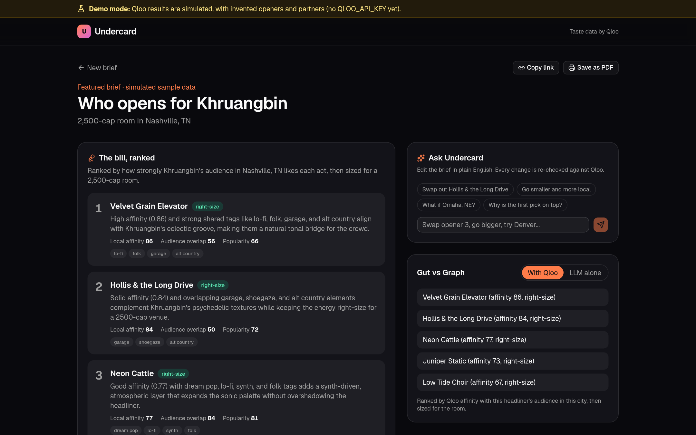
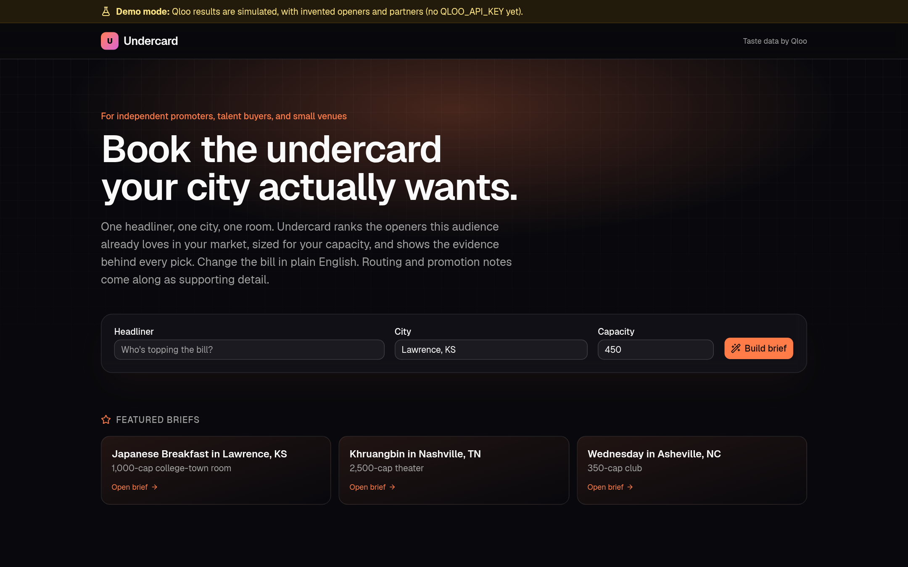
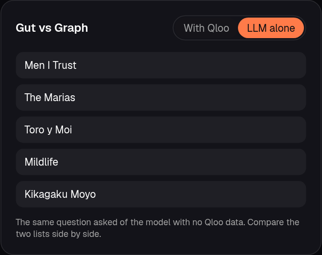
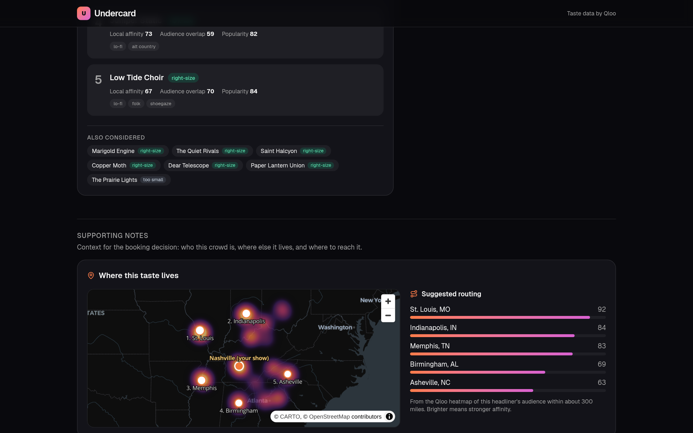
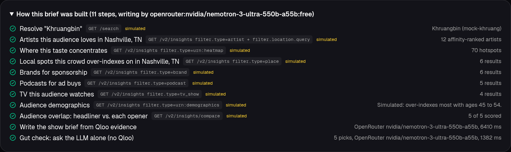
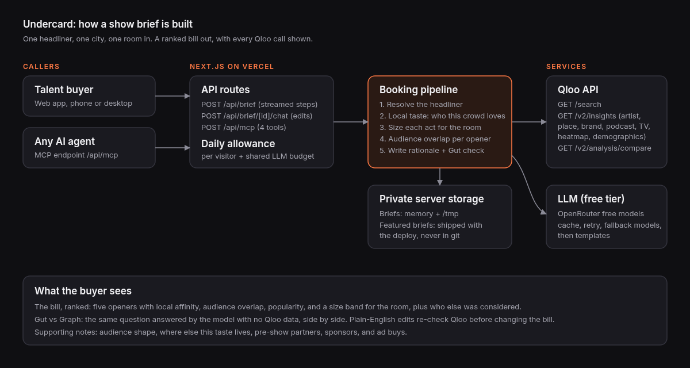

# Undercard

**Who opens this show, in this room, in this city.**

Talent buyers at independent venues pick support acts every week, mostly from memory, agent pitches, and streaming numbers that say nothing about their own market or their room. Undercard answers that one booking question with Qloo taste data: give it a headliner, a city, and your capacity, and it ranks the openers this headliner's audience already loves in your market, sized for your room, with the evidence behind every pick.

Live demo: https://undercard-phi.vercel.app (no login). Until the Qloo hackathon key is issued, every Qloo response in the demo is simulated with invented names and is labeled as such on screen.



## What it does

- **The bill, ranked.** Five openers, each with local affinity, audience overlap with the headliner, Qloo popularity, and a size band for your room (right-size, stretch, too big, too small). The next acts considered are listed underneath, so you can see why they missed.
- **Which one?** When a name matches more than one artist in Qloo, Undercard asks before it builds.
- **Ask Undercard.** Change the bill in plain English ("swap opener 2", "go smaller", "what if Omaha?"). Every change is re-checked against Qloo.
- **Gut vs Graph.** The same question asked of the model with no Qloo data, side by side.
- **Supporting notes.** Audience shape, where else this taste lives (Qloo heatmap), pre-show partners, sponsors, and ad buys. Useful context, deliberately secondary.
- **Share, print, and agents.** Copy a link, save a print-ready PDF, or call the same tools from any agent over MCP at `/api/mcp`.

| | |
| --- | --- |
|  |  |
|  |  |

## How it works



## Qloo calls

Every call uses only parameters documented in Qloo's reference ([docs-public](https://github.com/qloo/docs-public/tree/main/reference)), goes to `https://hackathon.api.qloo.com` with the `X-Api-Key` header, and is listed in the in-app trace. Qloo ignores unknown parameters silently, so each one will be verified live, with non-empty results, the day the key arrives.

| Step | Call |
| --- | --- |
| Resolve the headliner, ask "Which one?" if ambiguous | `GET /search` with `query`, `types=urn:entity:artist`, `take` |
| Artists this audience loves in the city | `GET /v2/insights` with `filter.type=urn:entity:artist`, `signal.interests.entities`, `signal.location.query`, `take` |
| Go smaller or bigger | the same call plus `filter.popularity.max` or `filter.popularity.min` |
| Audience overlap, headliner vs. each opener | `GET /v2/analysis/compare` with `a.signal.interests.entities`, `b.signal.interests.entities` |
| Audience shape | `GET /v2/insights` with `filter.type=urn:demographics`, `signal.interests.entities` |
| Where this taste lives | `GET /v2/insights` with `filter.type=urn:heatmap`, `signal.interests.entities`, `filter.location.query`, `filter.location.radius` |
| Pre-show partners | `GET /v2/insights` with `filter.type=urn:entity:place`, `signal.interests.entities`, `filter.location.query` |
| Sponsors, podcasts, TV | `GET /v2/insights` with `filter.type` brand, podcast, or tv_show, `signal.interests.entities`, `signal.location.query` |

Location parameters follow the docs: `filter.location.*` is documented for places, destinations, and heatmaps; other entity types are localized with `signal.location.query`.

Qloo data never enters this repository. Responses are cached privately on the server. Featured briefs are built ahead of time into `data/featured/` (gitignored) and shipped only inside the deployment; a test fails if any Qloo-derived file is ever tracked.

## Gut vs Graph benchmark

`pnpm benchmark` runs twelve fixed cases (real headliners, cities, and room sizes in `src/lib/benchmark/cases.ts`) through the real pipeline and scores both lists with one rule, stated in `src/lib/benchmark/score.ts`:

> A pick counts when it appears in Qloo's top 50 artists for this headliner's audience in this city and its popularity is right-size or a stretch for the room. Score = counted picks out of 5.

The ruler is Qloo's own data, which Undercard also uses to choose, so this measures fit to local taste and room size as Qloo sees it, not ticket sales. No results are published yet: the benchmark refuses to run without a live Qloo key, and `--dry-run` only exercises the harness on mock data.

## Daily allowance

The demo runs on free model quotas, so each visitor gets 3 fresh briefs and 8 edits a day, with a shared budget of 40 model calls a day per server instance. When a limit is reached, Undercard says so calmly and points to the featured briefs, which load with no model calls. If the provider's quota still runs out, briefs fall back to templated copy instead of failing. Limits are configurable in `.env.example`.

## Use it from any agent (MCP)

Undercard is an MCP server (Streamable HTTP, stateless) at `/api/mcp`, with the same pipeline, Qloo calls, and allowance as the web app.

| Tool | What it does |
| --- | --- |
| `build_show_brief` | Headliner, city, and capacity in; a ranked bill and supporting notes out. Ambiguous names return `needs_choice`; call again with `headliner_id`. |
| `get_show_brief` | Read a saved or featured brief by id. |
| `ask_undercard` | Edit or question a brief in plain English. City or capacity changes return a new brief id. |
| `list_featured_briefs` | Example briefs that are always available. |

```json
{ "mcpServers": { "undercard": { "url": "https://undercard-phi.vercel.app/api/mcp" } } }
```

## Run it

```bash
pnpm install
cp .env.example .env.local   # add QLOO_API_KEY and one LLM key (OPENROUTER_API_KEY recommended)
pnpm dev
```

Without keys the app runs in demo mode: Qloo responses are simulated with invented names (clearly labeled), and copy is templated.

## Checks

```bash
pnpm typecheck && pnpm lint && pnpm test && pnpm build
```

The tests run the full pipeline, the "Which one?" step, the API routes, the MCP tools, the daily allowance, and the benchmark scoring rule in demo mode, with no keys and no network.

## Stack

Next.js 16, React 19, Tailwind 4, shadcn/ui, MapLibre GL with CARTO basemaps, zod. The LLM layer is any OpenAI-compatible endpoint: OpenRouter free models by default (NVIDIA Nemotron 3 Ultra, with Gemma 4 and Nemotron 3 Super as fallbacks), or Groq, GitHub Models, or Gemini. Responses are cached by prompt hash, retried with backoff, and fall back to templates.

## What Undercard does not claim

- Qloo results describe aggregate taste affinities. They are not predictions about any individual and not a guarantee of ticket sales.
- The size bands are a simple mapping from capacity to Qloo popularity percentile, written by us, not an industry standard.
- Availability, fees, routing dates, and radius clauses are outside what Undercard knows. A buyer still makes the call.
- The demo's Qloo data is simulated until the hackathon key arrives.

## License

MIT
